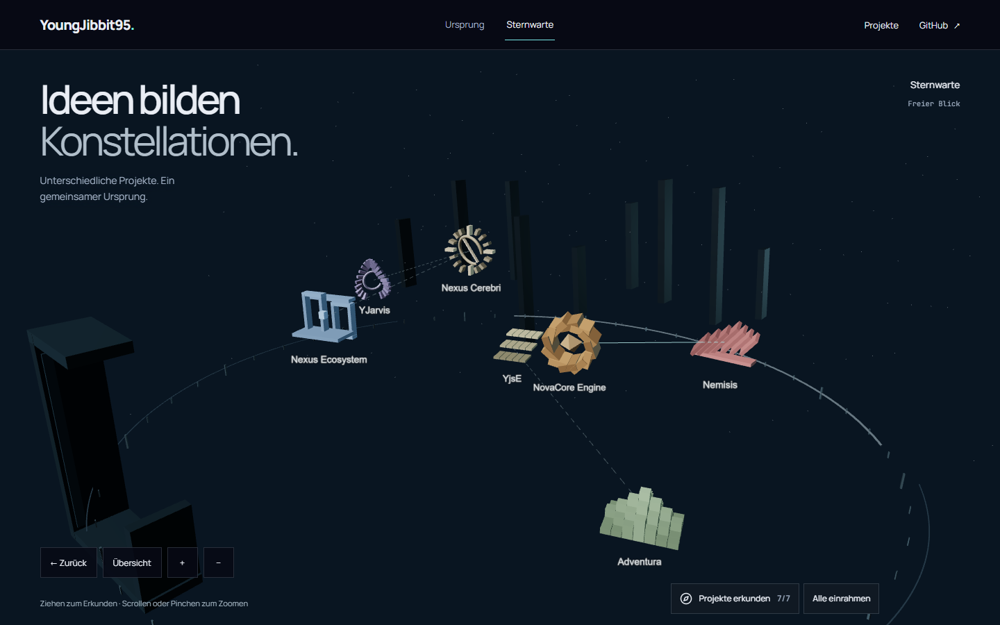

# G2-C — integrierte Projektsternwarte

G2-C implementiert sieben erkundbare Projektarchitekturen mit belegten Dossiers,
räumlichen Filtern und restaurierbarer Kamera. Ausgangs-HEAD war lokal, remote und
in Draft PR #1 `85a3204ff73f6457c356b3ee773a2d9b2b8a7205`. Alle Änderungen entstehen
im lokalen Checkout auf `feat/living-atlas-v3`; nur der Lead integriert und pusht.
G3, main-Merge und Produktionsdeploy bleiben gesperrt.

## Tatsächliche Zusammenarbeit

Fünf native Spezialisten und ein unabhängiger Reviewer arbeiteten in Wellen mit
höchstens drei gleichzeitig aktiven Kindern. Keine Rolle war nur ein Plan:

| Agent                       | Ergebnis / exklusiver Schreibbereich                     | Übergabe                                                                                                                                                         |
| --------------------------- | -------------------------------------------------------- | ---------------------------------------------------------------------------------------------------------------------------------------------------------------- |
| `/root/performance`         | Messskripte, Rohtraces, CSS-Integrationspatch            | Isolierter Worktree `F:/Coding/atlas-g2c-performance`, Branch `codex/g2c-performance`, Basis `85a3204`; Ergebnisse in `scripts/perf/` und `performance/` kopiert |
| `/root/project_data`        | Sieben Quellenmodelle, Cluster, Evidenzvalidierung       | Benannte Dateien `observatory/data/`, Data-Unit-Test, `G2_C_SOURCES.md`; Lead-Commit `d068190`                                                                   |
| `/root/spatial`             | Zwei gebaute Studien, sieben Geometrien, LOD, Bildbelege | `worlds/observatory/`, `ObservatoryWorld.tsx`, `observatory.css`, Art-Bericht/-Artefakte                                                                         |
| `/root/interaction`         | Reine Filterfunktionen, Explorer, Dossiers, native Links | `observatory/state/`, `observatory/ui/`, eigene Unit-Tests                                                                                                       |
| `/root/independent_qa`      | Unabhängige Browser-, Axe-, Pixel-, Ressourcenprüfung    | `tests/observatory*.spec.ts`, `G2_C_QA.md`, QA-Artefakte                                                                                                         |
| `/root/architecture_review` | Read-only Review ohne eigene Feature-Verantwortung       | Drei P1-Ursachen gefunden, Reparaturen erneut gelesen; keine weiteren P0/P1 im Reparatur-Diff                                                                    |

Lead besitzt Verträge, ExperienceRoot, Registry, Director, CameraRig, Canvas,
History und zentrale Konfiguration. Shared-Checkout-Agenten hatten disjunkte
Dateibereiche; nur A nutzte einen zusätzlichen Worktree. Tests, Browserports und
Ausgaben waren getrennt. Die letzte Performance-Welle erhielt ein ruhiges Fenster
ohne gleichzeitig laufende Builds oder Browsersuiten.

## Raum, Bedeutung und Bedienung

Die sieben IDs bleiben `nexus,cerebri,novacore,nemisis,adventura,yjse,jarvis`.
Der [Quellenbericht](G2_C_SOURCES.md) fixiert jede geprüfte GitHub-Revision.
Nur NovaCore → Nemisis ist eine belegte technische Beziehung. Drei weitere
Kanten sind ausdrücklich thematisch; sämtliche Architekturen sind Interpretationen.
Cerebri wird als unveröffentlicht, YJarvis als experimentelles Local v1 dargestellt.

Rund 800 Einheiten zwischen Projektankern, ein Meridian von etwa 1080 Einheiten
und eine entfernte Pfeilerregion erzeugen einen zusammenhängenden Raum. Sieben
unterschiedliche Silhouetten ersetzen den G1-Prototyp. Hauptkörper, Satelliten und
Nahdetails wechseln anhand realer Kameradistanz und Frustum, mit Hysterese und
angepasster mobiler Reichweite. Filter entfernen Körper und Kanten aus Darstellung
und Trefferbehandlung. Es gibt weiterhin einen persistenten R3F-Canvas, eine
CameraControls-Instanz und einen SceneDirector.

Suche sowie Kategorie-, Technologie-, Status- und Clusterfilter sind kombinierbar.
Leerzustand und Reset, Fit All/Cluster, Quellen-Dossiers, Kantenwahl, native Links,
Pfeiltasten, Maus/Pan/Zoom und Touch/Pinch sind umgesetzt. Ein explizit geöffnetes
Explorer-Panel lässt die Welt zunächst sichtbar. Die Browser-History speichert
Position, Target, FOV, Zoom, Auswahl und Filter; die URL enthält navigierbare
Projekt- und Filterzustände. Kein zweiter Router oder neuer Runtime-Baustein.

## Designentscheidung und echte Bilder

[Art Review](G2_C_ART.md) vergleicht zwei tatsächlich gerenderte Studien bei
1440/390. Meridian wurde wegen lesbarer Silhouetten und größerer räumlicher
Offenheit gewählt; Strata wiederholte Sockel und verdeckte Beschriftungen.
Das isolierte Art-Harness importiert dieselbe Produktionswelt. Die folgenden
Aufnahmen stammen zusätzlich aus der vollständig integrierten App:

- [Mobile Übersicht](evidence/g2c/qa/g2c-overview-390.png)
- [Mobile Clusteransicht](evidence/g2c/qa/g2c-cluster-390.png)
- [Mobile NovaCore-Nahansicht](evidence/g2c/qa/g2c-project-390.png)
- [Mobiles Dossier](evidence/g2c/qa/g2c-dossier-390.png)
- Weitere Übersicht/Cluster/Fokus bei 768/1920 sowie sieben Einzelportraits:
  [QA-Artefakte](evidence/g2c/qa/).

Der Lead hat integrierte Desktop-/Mobile-Aufnahmen visuell geprüft und Suche,
Cerebri-Fokus und Dossier zusätzlich im Codex-Browser bedient. Die mobile
Gesamtübersicht zeigt absichtlich kleine Formen; Cluster und Nahkameras tragen
die Erkundung. Eine menschliche Art-Abnahme bleibt separat von grünen Tests.

## Performance und Grenzen

[Messbericht](performance/G2_C0_PERFORMANCE.md) und Rohtraces dokumentieren je
drei vergleichbare Baseline-/Optimierungsläufe. `content-visibility: auto` für
unterhalb des Viewports liegende, prerenderte Legacy-Kapitel ist übernommen:

| Metrik, Median                              | Baseline | CSS-Optimierung |
| ------------------------------------------- | -------- | --------------- |
| Style/Layout                                | 1539 ms  | 717 ms          |
| Echter gerenderter Origin-Frame             | 12.085 s | 10.101 s        |
| Navigation bis erfolgreiche Kamera-Ruhepose | 14.940 s | 12.544 s        |
| FCP (Lighthouse Simulation)                 | 4.236 s  | 4.233 s         |
| LCP (Lighthouse Simulation)                 | 4.415 s  | 4.494 s         |
| TBT (Lighthouse Simulation)                 | 1926 ms  | 2425 ms         |

Die Optimierung verbessert Layout und tatsächliche Startbereitschaft; sie beweist
keinen allgemeinen Web-Vitals-Pass. TBT ist schlechter und bleibt offen. Die
historische einzelne G2-B-LCP von 10.9 s ist kein geeigneter gepaarter Vergleich.
Eager-Preload-Varianten wurden nach gemessenen FCP-/LCP-Regressionswerten verworfen.
Echte 3D-Pixel und eine erfolgreiche Kameraeingabe bleiben Teil der Messung.

Die [integrierte Abschlussmessung](performance/INTEGRATED_G2C_PERFORMANCE.md)
prüft beide vollständigen Welten jeweils dreimal mit Lighthouse und separat mit
realer CDP-Drosselung; Streuung und Rohtraces sind dort verlinkt:

| Median im integrierten Build   | Origin            | Observatory       |
| ------------------------------ | ----------------- | ----------------- |
| FCP / LCP                      | 4.459 / 4.874 s   | 4.453 / 5.282 s   |
| TBT / CLS                      | 2065 ms / 0.0146  | 905 ms / 0.0146   |
| Echter Frame / Kamera-Ruhepose | 10.139 / 12.770 s | 10.525 / 14.411 s |
| Längster simulierter Task      | 2027 ms           | 865 ms            |

Der CSS-Gewinn bleibt integriert erhalten. Die Origin-Ziele LCP ≤4.8 s und
TBT ≤2 s werden weiterhin knapp verfehlt und wurden nicht angehoben. Initiale
Weltdatei: Observatory 11.33 kB raw / 4.33 kB gzip; gemeinsamer Renderer
862.66 / 229.04 kB (Vite-Ausgabe). Der Measurement-Build ist per Dateihash fixiert;
danach wurden eine mobile Offen-Panel-CSS-Regel gegen verdeckten Tastaturfokus
und ein ereignisgesteuerter Renderer-Diagnose-Listener ergänzt. Die CSS-Regel greift
im gemessenen geschlossenen Startzustand nicht; der Listener fordert keinen Frame
an. Die Messung wird trotzdem nicht als byteidentischer finaler Build bezeichnet.

Serverseitige gzip-Größen sind geprüft. Der Browsertransport normalisiert jedoch
komprimierte Antworten; daraus lässt sich kein ehrlicher gzip-Ladezeitgewinn
ableiten. Chromium/SwiftShader, CPU-/Netzwerk-Drosselung und Lighthouse-Simulation
werden getrennt ausgewiesen. Kein tatsächliches Smartphone, Safari/Firefox,
Screenreader-Hardware, VRAM, FPS, Energieverbrauch, INP oder Feld-CWV wurde gemessen.

## Reparaturen, Prüfungen und nächste Abnahme

- Kameraabbruch: imperativer Pan/Dolly informiert jetzt auch den Director;
  Fokuswechsel können keine veraltete Zielpose mehr nachträglich festschreiben.
- Sichtbarkeit: Three raycastet unsichtbare Meshes; alle Vorfahren werden vor
  Ereignisbehandlung geprüft. Gefilterte und verborgene LOD-Treffer bleiben wirkungslos.
- Unicode: gültige 160-Zeichen-Suchen bleiben einschließlich CJK/Emoji in URL/History.
- Mobile Panel: verdeckte Kameraknöpfe sind während des geöffneten Dossiers nicht
  mehr per Tab fokussierbar; nach Escape sind sie wieder verfügbar.
- Vercel-Guidelines: eindeutige Formnamen, native Links mit passenden Filter-URLs,
  Tastatur/Escape/Fokusrückgabe, reduzierte Bewegung, 44-px-Ziele und Axe geprüft.
  Die [Quelle](https://raw.githubusercontent.com/vercel-labs/web-interface-guidelines/main/command.md)
  wurde am 11.10.2026 erneut abgerufen.
- Taste/Redesign: zwei gebaute Richtungen, lesbare Silhouetten und eigenständige
  mobile Kameras. Vercel React: lazy Welt, instanzierte Geometrie, diskrete
  LOD-Zustände und kein React-Update pro Kameraframe. Atlas Design/QA: Belegketten,
  echte Kamera-/Pixelprüfungen, getrennte technische und visuelle Gates.
- Lenis-Entscheidung aus [ADR-003](decisions/ADR-003-document-scroll.md) bleibt
  nach dem dortigen echten Integrationstest bestehen; keine erneute Installation.

Finale lokale Engineering-Prüfung:

| Gate                                  | Ergebnis                                                                                   |
| ------------------------------------- | ------------------------------------------------------------------------------------------ |
| TypeScript / Build / Prerender        | PASS                                                                                       |
| Root-Unit                             | 22/22 PASS                                                                                 |
| Vollständige Produktions-Browsersuite | 65/65 PASS nach CI-Reparatur, 5.0 Minuten, null Retries                                    |
| Unabhängige neue QA                   | 16/16 plus zusätzlicher Fokusfall 1/1, jeweils null Retries                                |
| G0                                    | 6 Unit-Tests; Build; 16 Browser-Passes, 8 bestehende gerätespezifische Skips, null Retries |
| Prettier                              | PASS                                                                                       |
| Zusätzlicher G1-Stress                | 3/3 PASS nach CI-Reparatur, 33.6 Sekunden, null Retries                                    |
| Exakter Feature-HEAD in GitHub        | Beide Workflow-Ergebnisse im PR-Abschluss verlinkt; kein alter grüner SHA als Ersatz       |

[Root-Abschlusslog nach CI-Reparatur](evidence/g2c/verification/root-browser-after-ci-repair.log),
[vorheriges Root-Log](evidence/g2c/verification/root-browser.log) und
[G0-Log](evidence/g2c/verification/g0-browser.log) sowie
[Stress-Log](evidence/g2c/verification/g1-stress.log) sind archiviert.
[Erneuter G1-Stress nach CI-Reparatur](evidence/g2c/verification/g1-stress-after-ci-repair.log)
bestand ebenfalls 3/3 ohne Retry.
G0 benötigte lokal ein frisches `npm ci`; wegen fehlerhafter Windows-Script-
Auflösung wurden anschließend die installierten TypeScript-/Vite-/Playwright-
Entrypoints direkt ausgeführt. Die CI prüft zusätzlich die regulären npm-Skripte.
Frühe Entwicklungsfehler und HMR-beeinflusste Läufe sind im unabhängigen QA-Bericht
offengelegt; sie werden nicht als stabile erste Passes ausgegeben.

Die erste vollständige CI auf `5b81237` bestand mit **zwei Retries** in der Root-Suite.
Der [CI-Reparaturbericht](G2_C_CI_REPAIR.md) erhält diese Historie und die Trace-Ursachen:
veraltete DOM-Ressourcenzähler nach verzögerter Freigabe sowie ein 22-Sekunden-Stall
bei der Erstellung eines Legacy-Browserkontexts. Frische Renderer-Abfragen nach
Browser-Leerlauf und ein eigenes Legacy-Browserprojekt reparieren die Messgrenze
beziehungsweise isolieren die Last. Assertions, Timeouts und Gesamtzahl von 65
Tests bleiben erhalten. Die Ressourcenprüfung bestand danach 3/3 ohne Retry,
mit konstant 23 Geometrien, sieben Texturen und sechs Programmen an zwölf
vergleichbaren Messpunkten. Auch die vollständige lokale Suite bestand auf dem
Reparaturstand 65/65 ohne Retry; der GitHub-Abschluss wird im PR mit seinem
exakten SHA berichtet.

Ursprüngliche Pixelgrenzen und Assertions bleiben erhalten; nur das erwartete
Nexus-Ziel wechselt mit seiner neuen Position von -10 auf -230 bei identischer
Toleranz. Die vollständige Suite umfasst die 48 bisherigen und 17 neuen Fälle.

G2-D beginnt mit den verbleibenden Start-Long-Tasks, Zielgerätmessungen und
visueller Abnahme der mobilen Übersicht. Das konkrete Laborbudget steht im
Performance-Bericht. G3 bleibt freigabepflichtig. Der ursprüngliche ZIP bleibt
untracked erhalten. Eine während der Arbeit beobachtete nicht zugeordnete Lockfile-Umsortierung
(nur zwei `devOptional`-Metadaten entfernt, alle Versionen/Integritäten identisch)
wird unverändert bewahrt und nicht Teil dieser Feature-Commits; Sicherheitskopie
unter `.verification/g2c-lock-observed.json`.
