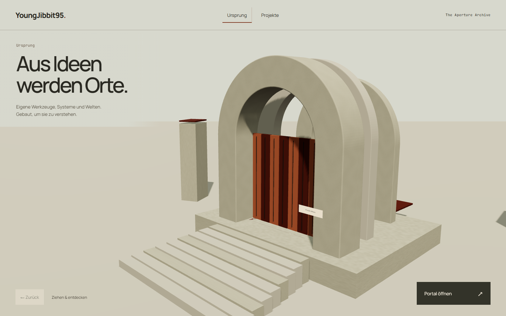
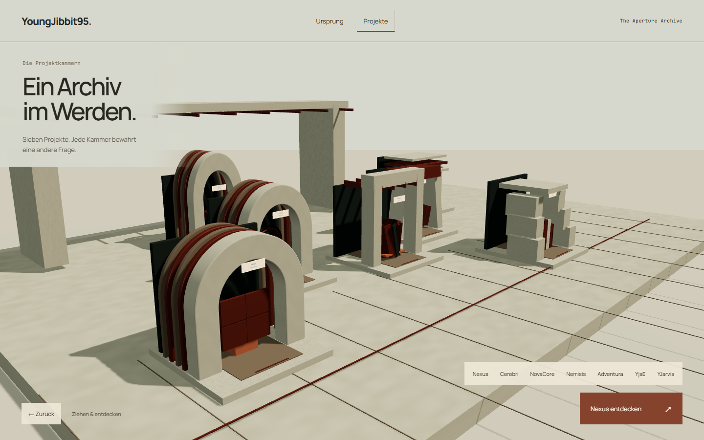
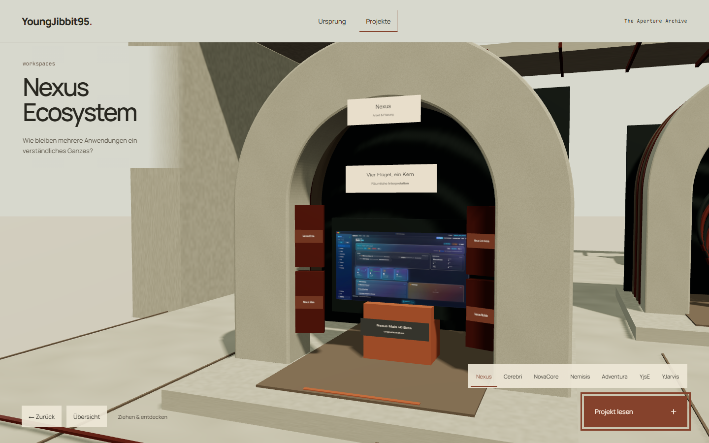
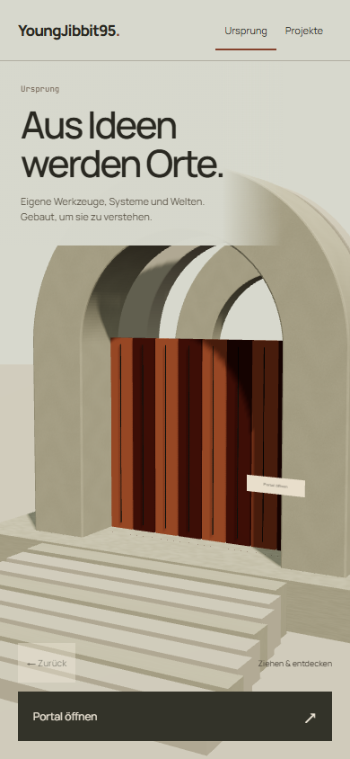
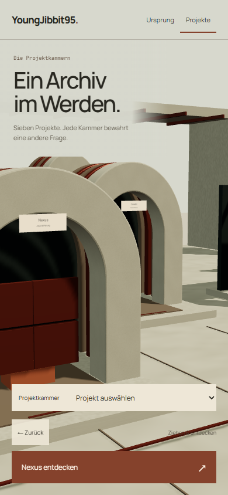
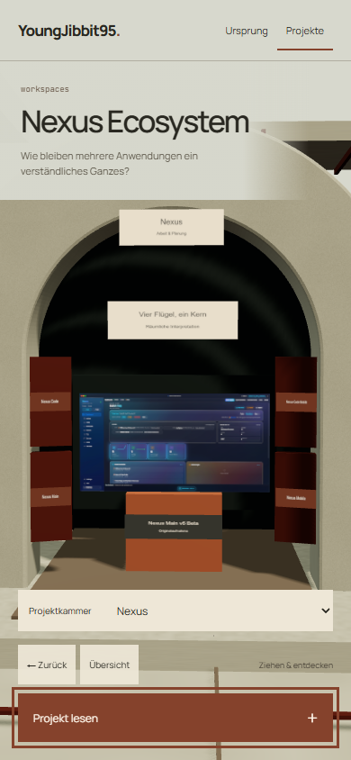

# Richtung A: The Aperture Archive

**Status: eigenständiger R3F-Browserprototyp für den menschlichen Richtungsentscheid. Keine Produktionsintegration, keine visuelle Freigabe.**

Ausgangs-HEAD `c2e338cf723f1ec6e20b4493175a8783ac95b405`. Nur
`experiments/g2d-design/direction-a`, dieses Dokument und `evidence/g2d/a` wurden
von Art Agent A verändert. Die anderen Richtungen wurden weder gelesen noch kopiert.

## Leitgedanke

Software erhält eine begehbare Adresse. Ein monumentales Portal aus Kalkstein und
Kupfer öffnet in Origin den Zugang zu einem Archiv persönlicher Arbeit. Observatory
setzt dieselbe Materialfamilie als Nachbarschaft verschiedener Projektkammern fort.
Die Welt ist weder eine kosmische Punktkarte noch ein dekorativer Datenmonitor.

Der Gegensatz zwischen massiven, ruhigen Hüllen und sichtbar veränderbaren inneren
Werkzeugen passt zur persönlichen Frage, wie Systeme entstehen und verständlich
bleiben. Das Archiv behauptet keine historische Institution; es ist eine räumliche
Interpretation der tatsächlichen Projekte.

Taste-Lesart: persönliches Entwicklerportfolio für neugierige Besucher und technische
Leser, monumentale architektonische Bildsprache. `DESIGN_VARIANCE: 8`,
`MOTION_INTENSITY: 5`, `VISUAL_DENSITY: 3`. Native CSS, vorhandenes React/R3F/Three,
keine neue UI-Bibliothek, kein Framework oder fremdes Asset hinzugefügt.

## Raum, Licht und Material

- Origin: drei hintereinander geschnittene Steinbögen mit tiefer Laibung, realer
  Treppenfolge und einer körperlichen Kupferlamellen-Tür. Vordergrund, Schwelle und
  dahinterliegende Tiefe sind tatsächlich dreidimensional.
- Observatory: Nexus im Vordergrund, Arbeit/Planung tiefer links, Weltenbau rechts,
  YJarvis in einer geschützteren hinteren Kammer. Die erste serielle Reihe wurde nach
  tatsächlicher Desktop-Sichtprüfung in Nachbarschaften umgebaut.
- Nexus: großer offener Rundbogen. Cerebri: mehrere tiefe zeitliche Ringschnitte.
  NovaCore: freigelegtes Stützen-/Trägersystem. Nemisis: gerichtete schräge Laibung.
  Adventura: gestufte Terrassenöffnung. YjsE: flache geschichtete Dachlagen.
  YJarvis: höherer, engerer Einschnitt.
- Eigene deterministische Oberflächentextur, raue helle Steinflächen, oxidierte
  Kupferteile, dunkle geschützte Innenflächen. Ein schräges Tageslicht wirft echte
  Schatten; kühles Himmelslicht erhält die Lesbarkeit der Schattenseiten.
- Kein Bloom, keine Partikel, kein Nebel, keine HDRI-Downloads. Die erste zu wellige
  Materialprobe wurde nach Screenshotprüfung zurückgenommen. Sockel und Treppen
  wurden mit dem Boden verbunden.

## Tatsächliche Entdeckung

Origin: „Portal öffnen“ dreht acht echte Mesh-Lamellen. Die Annäherung sieht durch die
jetzt freigelegte Schwelle. „Projekte betreten“ wechselt im selben Canvas in die Halle.

Nexus: Übersicht → Kammer ansteuern → Kammer öffnen. Vier physische Flügel treten
auseinander. Sichtbar werden die Namen Nexus Main, Nexus Mobile, Nexus Code und
Nexus Code Mobile sowie eine **echte historische Nexus-Main-v6-Beta-Aufnahme**.
Die Aufnahme ist im Raum und im HTML ausdrücklich historisch gekennzeichnet und
belegt keinen aktuellen Repository-Build. Die vier öffentlichen Clients wurden am
[gepinnten README](https://github.com/YoungJibbit95/Nexus-Ecosystem/blob/835cd116174981efe2f330b1083552091f52f808/README.md)
erneut gelesen. Keine Cloud-/Sync-Produktionsbehauptung wird aus der Geometrie abgeleitet.

Alle sieben HTML-Texte stammen direkt aus dem bereits geprüften
`src/experience/observatory/data/index.ts`, einschließlich Status, Quellenrevision und
Grenzen. Die Bildherkunft bleibt [public/media/nexus/SOURCES.md](../../../public/media/nexus/SOURCES.md).

## Macro, Meso, Micro und Mobile

| Blick             | Desktop                                              | Mobile                                                                          |
| ----------------- | ---------------------------------------------------- | ------------------------------------------------------------------------------- |
| Origin            | Großer Portalaufbau rechts, lesbare Einführung links | Vertikale Torschwelle statt verkleinerter Gesamtkarte                           |
| Observatory Macro | Vorderer Nexus-Ort, weitere Gruppen in echter Tiefe  | Eingang zwischen Nexus und Cerebri, alle Kammern über natives Select erreichbar |
| Meso              | Schräger Blick in eine konkrete Kammer               | Frontnahe, ruhigere Kamerapose                                                  |
| Micro             | Physisches Öffnen und freigelegter Inhalt            | Großes Architekturfenster; Quellenlesen über fokussierten Dialog                |

Die mobile Übersicht ist bewusst keine gleichzeitige Vogelperspektive aller sieben
Orte. Sie priorisiert einen glaubhaften Einstieg und große, steuerbare Nähe. Ob diese
Führung gegenüber einer vollständigen Karte bevorzugt wird, ist Teil der Nutzerwahl.

Bedienung: echte Drag-/Rad-Kamera, Touch-Unterstützung von CameraControls, Pfeiltasten,
native Projektbuttons und genaue Rückkehr zur zuvor gespeicherten Position und zum
Ziel. Ein Canvas, eine CameraControls-Instanz, Rendering nur auf Anforderung.
Kamerafahrten, Pfeiltasten und Türbewegung respektieren Reduced Motion. Keine automatische Dauerschleife.
Der Lesedialog setzt den Hintergrund inert, begrenzt Tab-Fokus, schließt per Escape
und gibt den Fokus nach Entfernen von inert zurück. Mobile Tasten haben mindestens
44 px Höhe; Safe Areas und eigenständiges Scrollen des Dialogs sind berücksichtigt.

## Tatsächlich untersuchte Referenzen und Skills

[basement.studio](https://basement.studio/) wurde in einem echten Browser geöffnet,
die erste große räumliche Ansicht und der Übergang zum typografischen Abschnitt
wurden betrachtet. Konkrete Lehre: zuerst einen zusammenhängenden Ort mit dominanter
Perspektive zeigen, danach Informationen klar in der Hierarchie führen. Weder dessen
schwarzweiße Linienwelt noch Assets, Layout oder Code wurden übernommen.

G2-C Desktop-/Mobile-Aufnahmen wurden vor Beginn inspiziert. Diagnose: isolierte
Körper, zu geringe Oberflächenidentität, zu kleine mobile Übersicht, Nähe ohne
ausreichenden Erkenntnisgewinn. Als Originalvision standen die lokalen
`ART_DIRECTION.md`, `PHASE_STATUS.md`, G2-C-Daten/Quellen zur Verfügung; der ursprüngliche
V4-Downloadpfad ist in dieser Sitzung nicht mehr vorhanden und wurde nicht als erneut
vollständig gelesen ausgegeben.

Gelesen und konkret verwendet:

- Living Atlas Experience Design: echte Wide/Approach/Detail-Posen, kausale Öffnung,
  quellengleicher HTML-Inhalt, echte Pixel-/Bildprüfung.
- Design Taste Frontend: Design Read, bewusstes Dial-Set, niedrige Overlay-Dichte,
  Typografie und große Bildfläche. Generische Marketing-Regeln über alternative
  Marken, Pflicht-Frameworks oder Stockbilder wurden dem Projektauftrag untergeordnet.
- Redesign Existing Projects: Audit vor Aufbau, vorhandene Runtime bewahrt,
  Material- und Identitätsschwächen anhand von Bildern iteriert.
- Vercel React Best Practices, insbesondere `rerender-use-ref-transient-values`
  und `rendering-hoist-jsx`: Kamera/Tür in refs, geometrische Konstanten geteilt,
  keine Frame-für-Frame-React-Zustandsänderungen, gezielte drei-Imports.
- Living Atlas World QA und die frisch abgerufenen
  [Vercel Web Interface Guidelines](https://raw.githubusercontent.com/vercel-labs/web-interface-guidelines/main/command.md):
  echte Canvas-Pixel, Fokus, Bilddimensionen, Safe Areas, Reduced Motion, keine
  DOM-Readiness als Ersatz für ein gezeichnetes Bild.

## Reproduktion und Nachweise

Aus dem Repository-Root:

```powershell
node node_modules/vite/bin/vite.js --host 127.0.0.1 --port 3011 --strictPort
node node_modules/typescript/bin/tsc -p experiments/g2d-design/direction-a/tsconfig.json
node node_modules/vite/bin/vite.js build --config experiments/g2d-design/direction-a/vite.config.ts
node experiments/g2d-design/direction-a/capture.mjs
```

URL: `http://127.0.0.1:3011/experiments/g2d-design/direction-a/`.
Alle Screenshots sind echte Browseraufnahmen, kein Compositing, kein KI-Mockup.
`capture.mjs` speichert sechs Zustände bei **1440×900** und **390×844**:
Origin Übersicht/offenes Portal, Observatory Übersicht, Nexus Annäherung/Entdeckung/Lesen.
Die Pixelprüfung blendet sämtliche HTML-Overlays aus, fotografiert die echten WebGL-Pixel
und prüft Kupfer-, Schatten- und Farbanteile. Die normalen Review-PNGs enthalten die UI.

[Renderer-/Interaktions-/Pixelwerte](../evidence/g2d/a/renderer-and-interaction-evidence.json),
[Capture-Log](../evidence/g2d/a/capture.log).

Der finale eigene Capture-Lauf endet mit Exit 0: beide Viewports, zwölf PNGs,
maskierte Canvas-Pixel, Mausfahrt, Tastaturaktivierung/-kamera, genaue Back-Pose,
Quellenlink, Dialog-Tab-Trap/Escape/Fokusretour, keine Pageerrors und kein horizontaler
Seitenüberlauf. Scoped TypeScript und eigenständiger Vite-Build bestehen. Der
Prototyp-Build bleibt unoptimiert gebündelt: **1.167,02 kB JS / 321,55 kB gzip**;
Vite meldet entsprechend seinen 500-kB-Chunkhinweis. Das wird nicht als Performance-
Pass bezeichnet. Die zwölf Bilder plus kleine Logs/JSON umfassen rund 4,4 MB.

Die unabhängige QA veranlasste einen stärkeren Titel-Scrim, ein natives mobiles
Projekt-Select statt abgeschnittener Leiste und dunkleren Gestentext. Diese Änderungen
sind bereits in den letzten eigenen PNGs enthalten. Anschließend wurden noch
Reduced Motion für Pfeiltasten und die 44-px-Wordmark-Hitbox korrigiert und per
TypeScript/Build geprüft; deren erneute Browserprüfung gehört zum seriellen
unabhängigen QA-Lauf. Art Agent A startet dafür keinen konkurrierenden Browser.

Die anschließende unabhängige Prüfung fand bei 768 px in der Nexus-Nähe einen
dunklen Dachbereich hinter der Header-Schrift und eine nur 42,9 px breite YjsE-Taste.
Der Header besitzt jetzt über alle Kameraansichten eine vollständig deckende helle
Fläche; Projektbuttons haben zusätzlich mindestens 44 px Breite. Diese gezielte
CSS-Reparatur verändert keine Szene oder Kameralogik. Die finale Bildschirmprüfung
übernimmt erneut die unabhängige QA; Art Agent A hat keinen weiteren Browser gestartet.

| Zustand               | 1440 px Calls / Triangles | 390 px Calls / Triangles |
| --------------------- | ------------------------- | ------------------------ |
| Origin Übersicht      | 38 / 8.668                | 35 / 8.632               |
| Observatory Übersicht | 167 / 56.332              | 82 / 55.352              |
| Nexus Entdeckung      | 68 / 48.702               | 56 / 41.742              |

Das sind Renderer-Zähler, keine FPS-, LCP-, TBT-, INP- oder Geräte-Geschwindigkeitsbehauptung.
Die Capture-Läufe nutzen Chromium mit Software-WebGL. Am Ende einer abgeschlossenen
Kamerabewegung bleibt der Framezähler im gemessenen 1,5-Sekunden-Fenster unverändert.

Die erste Testiteration entdeckte einen `Html`-Unmountfehler beim Verlassen der
Entdeckung. Die ursprünglichen verschachtelten React-HTML-Wurzeln wurden vollständig
durch echte texturierte Mesh-Schriftplatten ersetzt. Ein weiterer Test entdeckte,
dass synchroner Fokus beim Schließen noch auf einen inerten Hintergrund traf; Fokus
wird jetzt nach dem React-Commit zurückgegeben. Beide Fehler werden nicht als
bestandene erste Läufe verschwiegen.
Ein vorheriger Idle-Test las außerdem während des langen Dämpfungsauslaufs zu früh.
Er wartet jetzt auf das tatsächliche CameraControls-`sleep`-Ereignis und prüft danach
weiterhin unveränderte Framezahlen; die Idle-Grenze wurde nicht erhöht.

## Bilder für die Richtungswahl








## Stärken, Grenzen und nächste Entscheidungen

**Stärken:** eigenständige helle Materialwelt, große lesbare Schwelle, körperliche
Entdeckung, echte historische Arbeit im Raum, mobile Nähe ohne winzige Gesamtkarte,
gemeinsame Materialien mit unterscheidbaren räumlichen Hüllen.

**Offen:** Licht und Stein sind weiterhin prozedurale Konzeptmaterialien; teils harte
Schattenschnitte und kleine räumliche Beschriftungen in der Ferne brauchen weitere Art-
Iteration. Das siebenfache Archivmotiv kann als Ausstellung statt als lebendige Welt
gelesen werden. Das ist ein ehrlicher gestalterischer Tradeoff für den Review.
Nur Nexus besitzt bereits einen detaillierten inhaltlichen Öffnungsinhalt; die sechs
anderen Räume verbinden individuelle Skulpturen mit geprüften HTML-Dossiers.

Dieser isolierte Prototyp ersetzt nicht SceneRegistry/SceneDirector oder die Produktions-
History. Sein expliziter Back-Stack dient dem Konzepttest; browsernative URL-History,
Produktionssuche/-filter, vollständige No-WebGL-Fehlerbehandlung, Smartphone-Hardware-
Messung und komplette G0/G1/CI-Abnahme sind nicht als neu erfüllt behauptet. Die
Produktionsverträge wurden nicht verändert. Ein No-JS-Link führt zur bestehenden
inhaltlichen Website. Die endgültige Übertragung erfolgt ausschließlich nach
ausdrücklicher menschlicher Richtungsfreigabe.
